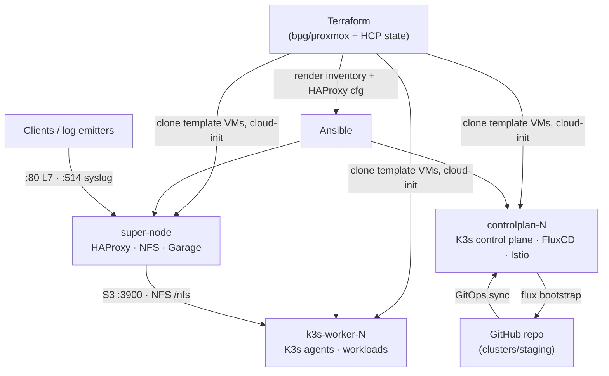

# Infra — K3s Platform on Proxmox


-46489f)


A Kubernetes lab platform on Proxmox. Terraform clones VMs from template VMs and renders the Ansible inventory and HAProxy config; Ansible builds a K3s cluster (embedded etcd, HA), Istio (ambient) + Gateway API, HAProxy L7 load balancing + syslog relay, NFS + Garage (S3) storage, and bootstraps FluxCD from GitHub. `terraform apply` builds the platform, `terraform destroy` tears it down.

## Architecture



### Node roles

| Role | Runs | Default spec |
|---|---|---|
| `super` (LB) | HAProxy (L7 LB + syslog relay), NFS server, Garage (S3) | 2 vCPU, 4 GB RAM, 32 GB disk |
| `master` | K3s control plane (embedded etcd), FluxCD, Istio control plane | 2 vCPU, 4 GB RAM, 32 GB disk |
| `worker` | K3s agents, workload pods | 2 vCPU, 8 GB RAM, 32 GB disk |

### Default nodes (from `terraform/variables.tf`)

| Name | VM ID | PVE node | IP | Cloned from |
|---|---|---|---|---|
| `edge` | 111 | proxmox-04 | 192.168.1.9 | 9500 |
| `controlplan-1` | 211 | proxmox-02 | 192.168.1.11 | 9400 |
| `controlplan-2` | 212 | proxmox | 192.168.1.12 | 9300 |
| `controlplan-3` | 213 | local | 192.168.1.13 | 9100 |
| `worker-1` | 221 | local | 192.168.1.21 | 9100 |
| `worker-2` | 222 | proxmox | 192.168.1.22 | 9300 |
| `worker-3` | 223 | proxmox-02 | 192.168.1.23 | 9400 |

### Scaling

`cluster_node_specs` is a map of role → **list** of VM specs, one entry = one VM (a map key holds only one value, hence the list). Add or remove entries to scale a role; set `node_name` per entry to spread VMs across PVE hosts. `locals.tf` fails early if two roles' IP ranges overlap.

## Architecture Decisions

| # | Decision | Why |
|---|---|---|
| 1 | K3s instead of full Kubernetes | Single binary, low memory, built-in etcd, works with Helm and the Gateway API |
| 2 | HA via embedded etcd | No separate database; first master initializes, the rest join with a shared token |
| 3 | One "super-node" for LB + NFS + S3 | Lab has limited VMs — edge services share one VM to save RAM and disks |
| 4 | Terraform owns VMs, Ansible owns software | Clean split: infrastructure state vs. software state |
| 5 | Per-VM spec entries | Scaling = adding/removing list entries; names, VM IDs, and IPs are explicit per VM |
| 6 | Clone from template VMs | Fast, consistent provisioning; cloud-init only sets hostname, user, SSH keys, and IP |
| 7 | Terraform renders the Ansible inventory + HAProxy config | No drift between topology and config — both come from the same variables |
| 8 | Disable Traefik and K3s local storage | Ingress via Gateway API/Istio, storage via NFS/Garage — no redundant components |
| 9 | crun default + youki `RuntimeClass` | Try alternative OCI runtimes via plain `runtimeClassName` |
| 10 | Istio ambient + Gateway API | Lightweight mesh with mTLS and a standards-based ingress API, no sidecars everywhere |
| 11 | Two storage tiers: NFS + Garage | NFS for shared file state, Garage for S3 objects |
| 12 | GitOps with FluxCD | `flux bootstrap github` binds the cluster to a repo; extra controllers enable automatic image updates |
| 13 | Secrets outside git | Terraform reads `secrets.auto.tfvars` (gitignored); Ansible reads env vars |
| 14 | Syslog fan-out through HAProxy | One entry point (`:514` TCP/UDP) balanced across all K8s nodes (`:30514`) |

## Tech Stack

| Category | Tools |
|---|---|
| Infrastructure | Proxmox VE, Terraform (`bpg/proxmox` 0.111.1, HCP remote state), Ansible |
| Kubernetes | K3s (embedded etcd), Istio 1.30 (ambient), Gateway API v1.6 |
| Container runtimes | crun (default), youki 0.7 (`RuntimeClass`) |
| Edge / logging | HAProxy (L7 LB, stats, syslog relay) |
| Storage | nfs-kernel-server, Garage 2.3.0 (S3-compatible) |
| GitOps | FluxCD (bootstrapped from GitHub) |

## Repository Structure

```text
.
├── ansible/
│   ├── ansible.cfg                        # python3.13, pipelining, roles path
│   ├── inventory/hosts                    # rendered by Terraform (hosts.tpl)
│   ├── logs/                              # quickstart.sh bootstrap logs
│   ├── playbooks/
│   │   ├── 00-prerequisites.yml           # disable IPv6 on all nodes
│   │   ├── 01-cluster-setup.yml           # HAProxy, K3s cluster, youki/crun, kubeconfig
│   │   ├── 02-servicemesh.yml             # Istio ambient + Gateway API
│   │   ├── 03-storage-networking.yml      # NFS server on the super-node
│   │   ├── 04-garage-deploy.yml           # Garage S3 on the super-node
│   │   ├── 05-gitops-bootstrap.yml        # FluxCD bootstrap from GitHub
│   │   ├── quickstart.sh                  # runs all playbooks in order
│   │   └── files/                         # fetched kubeconfig (gitignored)
│   └── roles/
│       ├── common/                        # base packages, qemu-guest-agent
│       ├── fluxcd/                        # Flux CLI + GitHub bootstrap
│       ├── garage/                        # Garage binary, config, systemd unit
│       ├── istio/                         # istioctl, ambient profile, Gateway API
│       ├── k3s-agent/                     # join workers
│       ├── k3s-server/                    # initialize / join masters
│       ├── load-balance/                  # HAProxy install + config
│       ├── nfs/                           # disk prep, exports, nfs-kernel-server
│       └── runtime/                       # youki + crun + containerd config
├── terraform/
│   ├── backend.tf                         # HCP Terraform (org: traipoap, workspace: proxmox)
│   ├── provider.tf                        # bpg/proxmox (SSH agent mode)
│   ├── variables.tf                       # networking + per-role VM spec lists
│   ├── locals.tf                          # flattens specs into the node map
│   ├── main.tf                            # clone VMs, cloud-init, wait for SSH, render files
│   ├── secrets.auto.tfvars                # gitignored — password + SSH keys
│   └── templates/
│       ├── hosts.tpl                      # → ansible/inventory/hosts
│       └── haproxy.tpl                    # → ansible/roles/load-balance/templates/haproxy.cfg.j2
└── README.md
```

## Quickstart

### Prerequisites

- A Proxmox VE host with:
  - Template VMs for cloning: **9100, 9300, 9400, 9500** — or adjust `clone_vm_id` per entry in `cluster_node_specs`
  - A bridge (default `vmbr0`) on the cluster subnet (default `192.168.1.0/24`, gateway `192.168.1.1`)
  - Datastores used in the default specs: `local`, `worker`
- A Proxmox user with API access
- Terraform CLI and an HCP Terraform account (org `traipoap`, workspace `proxmox`) — or switch `backend.tf` to a local backend
- Ansible on the control machine, with key-based SSH to the VMs (cloud-init injects your keys)
- A GitHub repository for Flux (default: `traipoap/gitops`) and a PAT with **read/write contents** (`--read-write-key`)

### 1. Clone the repository

```bash
git clone <this-repo> && cd infra
```

### 2. Configure Terraform

Create `terraform/secrets.auto.tfvars` (gitignored):

```hcl
proxmox_password = "CHANGE_ME"
ssh_public_keys  = ["ssh-ed25519 AAAA... you@example.com"]
```

Everything else has defaults in `variables.tf` — override via `terraform.tfvars` or `-var` as needed:

| Variable | Default | Purpose |
|---|---|---|
| `proxmox_endpoint` | `https://proxmox.example.com` | Proxmox API endpoint |
| `proxmox_username` / `proxmox_ssh_username` | `example@pam` / `example` | API and SSH usernames |
| `ssh_username` | `example` | User created on every VM via cloud-init |
| `network_bridge` / `cluster_subnet` / `gateway_ip` | `vmbr0` / `192.168.1.0/24` / `192.168.1.1` | VM networking |
| `cluster_node_specs` | see `variables.tf` | Per-VM list per role: name, VM ID, PVE node, CPU, RAM, IP, disks, clone source |
| `timezone` | `Asia/Bangkok` | Set on every VM |

### 3. Provision the VMs

```bash
cd terraform
terraform login
terraform apply
```

Terraform:

1. Generates per-VM cloud-init snippets (hostname, user, SSH keys, static IP)
2. Clones and configures the VMs (CPU, RAM, disks, bridge), then **blocks until every node is SSH-ready**
3. Renders `../ansible/inventory/hosts` and the HAProxy config from the same node list

### 4. Run the Ansible playbooks

```bash
cd ../ansible
export APP_GIT_SECRET="ghp_..."        # required for 05-gitops-bootstrap
# optional — auto-generated with secure defaults if unset:
export RPC_SECRET="$(openssl rand -hex 32)"
export ADMIN_TOKEN="$(openssl rand -A 64)"
export GARAGE_DEFAULT_ACCESS_KEY="GK$(openssl rand -hex 16)"
export GARAGE_DEFAULT_SECRET_KEY="$(openssl rand -hex 32)"

./playbooks/quickstart.sh
```

`quickstart.sh` runs the playbooks in order (15 s pause between them), stops on first failure, and tees to `ansible/logs/bootstrap-<timestamp>.log`:

| Playbook | What it does |
|---|---|
| `00-prerequisites` | Disables IPv6 on all nodes |
| `01-cluster-setup` | HAProxy on the super-node; K3s init on the first master (`--cluster-init`, traefik/local-storage disabled), serial join of extra masters and workers; youki + crun runtimes; fetches the kubeconfig to `~/.kube/config` (server rewritten to the LB IP, falling back to the first master) |
| `02-servicemesh` | Istio (ambient profile, CNI dirs tuned for K3s) + Gateway API CRDs |
| `03-storage-networking` | Prepares `nfs_disk_device` if set (partition + ext4 + mount), otherwise uses a plain directory on the root FS; exports `/nfs`; runs nfs-kernel-server |
| `04-garage-deploy` | Garage 2.3.0 (single-node) with a hardened systemd unit; data on `/nfs/data` |
| `05-gitops-bootstrap` | Flux CLI + `flux bootstrap github` (owner `traipoap`, repo `gitops`, branch `main`, path `./clusters/staging`, `--read-write-key --personal`, plus image-reflector/image-automation/source-watcher) |

Any playbook can also be run individually:

```bash
ansible-playbook -i inventory/hosts playbooks/02-servicemesh.yml
```

### 5. Verify

```bash
kubectl get nodes -o wide            # controlplane + workers Ready
kubectl get runtimeclass             # "youki" present
curl -s http://<super-node>:8080     # HAProxy stats (admin:securepass)
mc alias set garage http://<super-node>:3900 \
  $GARAGE_DEFAULT_ACCESS_KEY $GARAGE_DEFAULT_SECRET_KEY
ssh <user>@<master> 'flux get sources -A'   # Flux watching the repo
```

### Environment variables consumed by Ansible

| Variable | Required | If unset |
|---|---|---|
| `APP_GIT_SECRET` | Yes (playbook 05) | — |
| `RPC_SECRET` | No | auto-generated (64 hex) |
| `ADMIN_TOKEN` | No | auto-generated (64 alphanumeric) |
| `GARAGE_DEFAULT_ACCESS_KEY` | No | auto-generated (`GK` + 32 hex) |
| `GARAGE_DEFAULT_SECRET_KEY` | No | auto-generated (64 hex) |

## GitOps Workflow

Playbook `05-gitops-bootstrap` runs on the first master:

```bash
flux bootstrap github \
  --components-extra=image-reflector-controller,image-automation-controller,source-watcher \
  --owner=traipoap --repository=gitops --branch=main \
  --path=./clusters/staging --read-write-key --personal
```

- Flux provisions itself and creates the GitHub credentials to sync `traipoap/gitops`
- Watched path: `./clusters/staging` on `main` — commit Kustomizations, HelmReleases, ImagePolicies there and the cluster follows
- `--read-write-key` lets Flux push back (e.g. Flux-generated resources)
- Override `github_owner` / `github_repo` / `cluster_name` in `playbooks/05-gitops-bootstrap.yml`

## Storage

### NFS (super-node)

Driven by the `nfs` role variables (`roles/nfs/defaults/main.yml`):

- `nfs_disk_device` empty (default) → NFS exports a plain directory on the root filesystem
- Set it to a whole spare disk (+ `nfs_create_partition: true`) or a free partition (+ `false`) → the role partitions, formats ext4, and mounts it at `/nfs`
- Refuses to touch a device that is already mounted — never point it at the system root
- Export: `/nfs *(rw,sync,no_subtree_check,all_squash,anonuid=0,anongid=0)`

Intended for shared file state and as the backing volume for Garage.

### Garage (super-node, S3-compatible)

Single-node Garage 2.3.0 under a hardened systemd unit (`ProtectSystem=strict`, `NoNewPrivileges`, private tmp):

| Endpoint | Bind | Purpose |
|---|---|---|
| S3 API | `:3900` | region `garage`, root domain `*.s3.garage.localhost` |
| Web | `:3902` | root domain `*.web.garage.localhost` |
| Admin | `[::1]:3903` | loopback only, token-protected |

- Data: `/nfs/data`, metadata: `/var/lib/garage`
- `default-bucket` created at first start from the Garage keys
- Config in `/etc/garage.toml`; credentials in the systemd unit environment

## Load Balancing & Logging (super-node)

HAProxy (config rendered by Terraform from `templates/haproxy.tpl`):

- **`:80`** — L7 HTTP across master + worker nodes, `balance source` with `JSESSIONID` cookie stickiness
- **`:8080`** — stats page (`stats auth admin:securepass`)
- **`:514` TCP + UDP** — syslog relay fan-out to every K8s node on `:30514`

## Service Ports

| Service | Node(s) | Port(s) |
|---|---|---|
| K3s API | masters | 6443 |
| HAProxy L7 LB / stats | super-node | 80 / 8080 |
| Syslog relay (in) / receivers (out) | super-node / all K8s nodes | 514 → 30514 |
| NFS | super-node | 2049 |
| Garage S3 / Web / Admin | super-node | 3900 / 3902 / 3903 (loopback) |

## Security

- Secrets never land in git: `secrets.auto.tfvars` is gitignored, Ansible reads env vars
- Garage admin API bound to loopback only; systemd unit sandboxed
- IPv6 disabled across the lab; TLS 1.2+ enforced on HAProxy
- Flux uses a narrowly-scoped PAT (`--personal --read-write-key`) on one repo

> Lab platform. For production: move `admin:securepass` out of the templates, restrict the NFS export to the cluster subnet, terminate TLS at the edge.

## Destroying the Cluster

```bash
cd terraform
terraform destroy
```

Removes the cloned VMs and cloud-init snippets. Template VMs, the GitHub Flux repository, and local `~/.kube/config` are left in place.

## Troubleshooting

- **Terraform hangs on "Waiting for VMs to be SSH ready"** — cloud-init SSH key didn't land. Check the VM's serial console, `ssh_public_keys` in `secrets.auto.tfvars`, and the template VM's cloud-init support.
- **`flux bootstrap github` fails (playbook 05)** — `APP_GIT_SECRET` must be a PAT with read/write contents on the target repo; `ignore_errors: true` masks this — check the play log.
- **Worker won't join** — playbook 01 prints the cause. Verify reachability to the first master on `:6443` and that the node token is readable on the master.
- **`kubectl` not working locally** — playbook 01 copies the rewritten kubeconfig to `~/.kube/config`; re-run that play or fetch `/etc/rancher/k3s/k3s.yaml` from the master.
- **Garage credentials** — if auto-generated, the full values are in `/etc/garage.toml` and the systemd unit on the super-node.
- **HAProxy shows no backends** — confirm `inventory/hosts` and `haproxy.cfg.j2` were rendered by the latest `terraform apply` (both are generated files).
- **Ansible logs** — `ansible/logs/bootstrap-<timestamp>.log`
